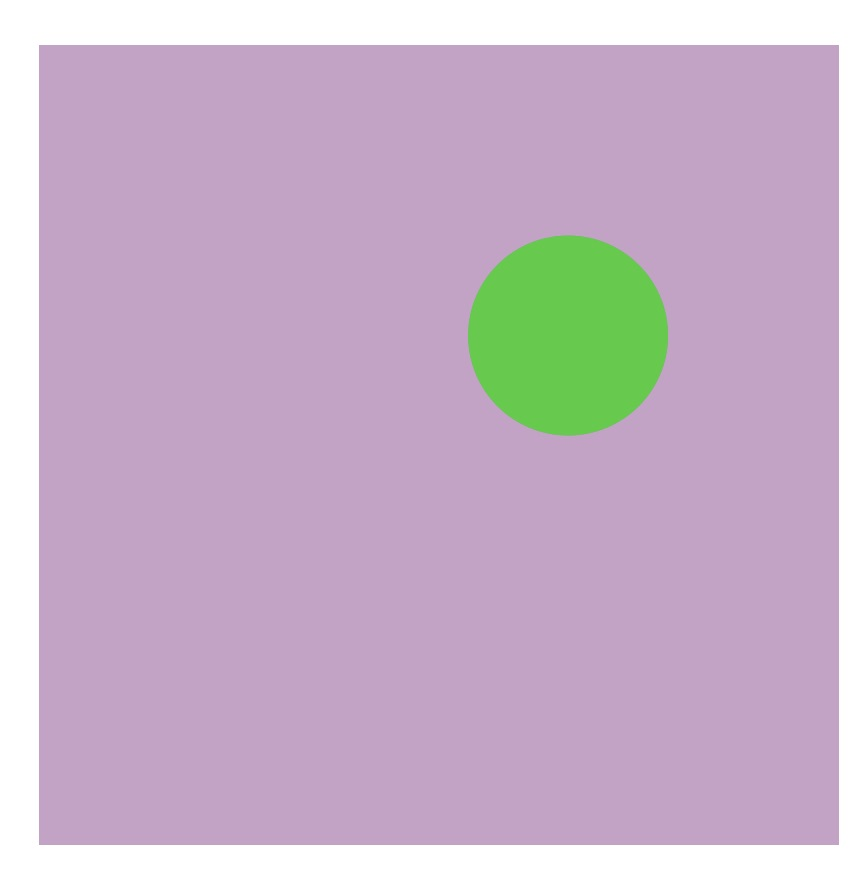
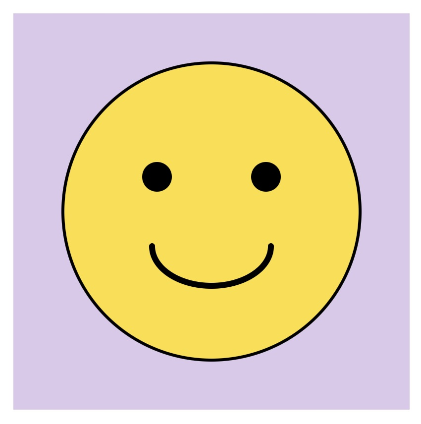
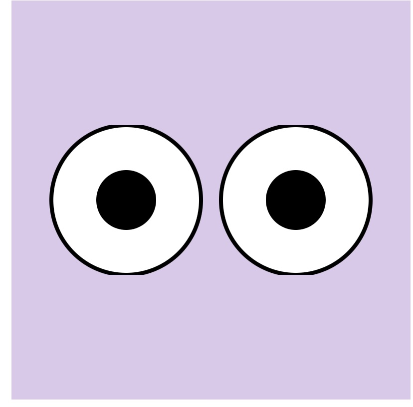
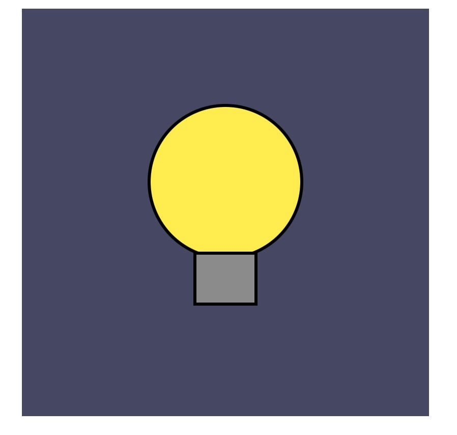
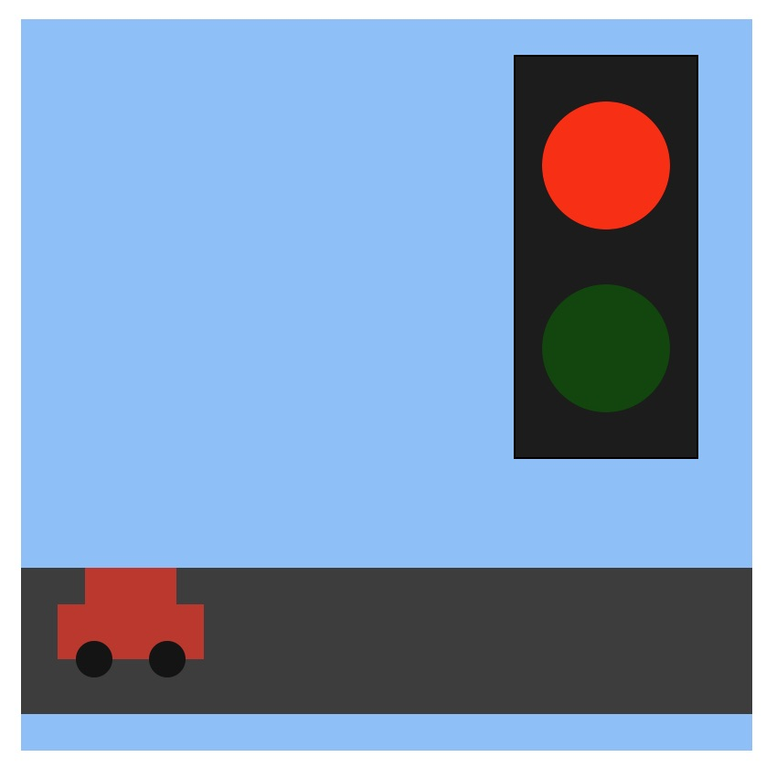
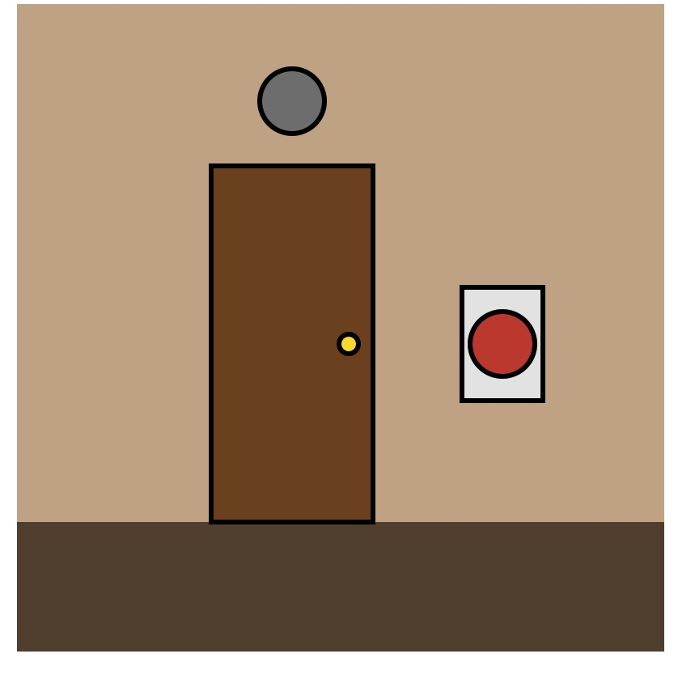

# Journal.md
## Alycia's Reflective Coding Journal 2026

### ***Process Journal*** – Making my website with Markdown & GitHub (Week 2 - Sept 13):

The image code gave me so much trouble, I kept getting it wrong and couldn't figure out why my image wasn't showing up. I also spent a long time trying to change the font and size of my title and subheading bc it looked weird at first and I just kept messing with it till it looked right.

Honestly, a lot of this is still hard for me to fully understand because I don't have much prior coding background to build on. I'm kind of learning the "why" behind the code as I go, instead of already knowing it.

What I hope is that when people (including future me) look back at this project, they can actually see the evolution. Where I start from really basic formatting and slowly moving into more detailed, cleaner edits and smarter coding techniques. I want that growth to be visible. My biggest goal is to eventually memorize these codes and techniques instead of constantly relying on cheat sheets. I want it to feel natural instead of like I'm decoding a puzzle every time. Slow progress is still progress.

### ***Process Journal*** – Making my 3 prototype projects P5 & GitHub (Week 3 - Sept 14):

This week’s prototypes were more about layering and figuring things out than I expected. I started with a fish made from basic shapes, then made a triple-scoop ice cream cone, and finished with an “abstract minion” using ellipses, rectangles, and arcs. I realized that a lot of making these characters is just putting simple shapes together in the right order. The minion especially showed me how much the layering matters.

The coolest part was seeing how far you can push basic shapes while still making them recognizable. Changing the arc angles to make a smile or scalloped edges felt like actual problem-solving instead of just placing random shapes.

The hardest part was definitely the coordinate math, especially making sure everything lined up properly when I resized things.

I hope people looking at my work can see how much personality you can create with simple shapes. I’d like to develop the minion more by making its eyes follow the mouse or making it “breathe.”

 Here are the prototypes; 
Prototype #1: 

Prototype #2: 

Prototype #3: 

### ***Process Journal*** – Making my 3 Variable Prototypes P5 & GitHub (Week 4- Sept 21):

This week I made three prototypes: Sunset, Heartbeat, and Nervous Dot. They all use variables to change different things while the program is running, but each one has its own feeling and purpose.What surprised me the most was how much you can do with simple math. In Sunset, the sun's position changes the colours of the sky using map(). In Heartbeat, I used sin() to make the heart pulse on its own, even when the mouse isn't moving. In Nervous Dot, random() makes the dot shake, and every click makes it bigger, redder, and more intense.

I also learned how useful JavaScript objects can be for keeping everything organized. The hardest part was understanding map() and getting the ranges right. Building the heart was also a bit tricky because I had to make sure all the shapes scaled properly together.

Overall, I liked seeing how a few variables and simple shapes could create different moods. I wanted Sunset to feel calm, Heartbeat to feel alive, and Nervous Dot to feel a little uncomfortable. If I continue working on Nervous Dot, I'd like to make the dot calm down over time or add sound to make the experience more intense.

 Here are the variable prototypes; 

Prototype #1: 

Prototype #2: 

Prototype #3: 

### ***Process Journal*** – Making my 3 Interactive Conditionals Prototypes P5 & GitHub (Week 5- Sept 28):

This week I made three prototypes: Shy Creature, Mr. Mercurial, and Sleepy Eyes. They all use conditions to change different things while the program is running, but each one has its own feeling and purpose. What I found interesting was how a few simple shapes and changes could make something feel like it has emotions. In Shy Creature, the creature changes colour and runs away depending on how close the mouse is. In Mr. Mercurial, the face changes its expression depending on the mouse's height. In Sleepy Eyes, holding the mouse makes the eyes slowly close, and releasing it makes them open again.

I also learned how useful conditions are for making a sketch react to what the user does. The hardest part was getting everything to work smoothly, especially making the eyes close gradually instead of all at once and making sure the creature reacts properly to the mouse. I realized that even though the projects look simple, there are a lot of little details in the code that make a difference.

Overall, I liked seeing how I could give each prototype a different personality without needing anything too complicated. I wanted Shy Creature to feel shy, Mr. Mercurial to show different emotions, and Sleepy Eyes to feel calm and sleepy. If I continue working on one of them, I'd like to develop Shy Creature further by adding more reactions and making it feel even more like a real little creature.

 Here are the conditionals prototypes; 

Prototype #1: 

Prototype #2: 

Prototype #3: 

### ***Process Journal*** – 3 Events Prototypes P5 & GitHub (Week 5- Sept 28):

This week I made three prototypes: Lightbulb, Stop Light, and The Barking Doorbell. They all use user input to change what happens in the sketch, but each one works a little differently. What surprised me the most was how one simple action, like pressing a key or clicking a button, could change an entire scene. In Lightbulb, holding the spacebar turns on the light, while letting go makes everything dark again. In Stop Light, clicking switches between red and green, which controls whether the car moves or stops. In The Barking Doorbell, clicking the button opens the door, turns on the light, and plays a dog bark before everything goes back to normal.

I thought it was cool how I could make the sketches feel more interactive by using different types of input. Adding sound and a timer to The Barking Doorbell was especially interesting because it made the scene feel more realistic and gave it a little surprise. I also liked how the car in Stop Light keeps moving and comes back on the other side of the canvas, which makes the scene feel like it never really ends.

The hardest part was understanding how to make everything happen at the right time and making sure each action worked properly. For example, The Barking Doorbell has to open when you click the button, stay open for two seconds, and then close automatically. I had to think about how different parts of the code work together instead of just focusing on one shape at a time.

Overall, I liked seeing how a few shapes, variables, and user interactions could turn into something more interesting. I wanted Lightbulb to feel like the light depends on you, Stop Light to make you feel in control of the car, and The Barking Doorbell to be funny and a little unexpected. If I were to develop one further, I would choose The Barking Doorbell because I think it would be fun to add different sounds or have different things appear behind the door each time you ring it.

 Here are the events prototypes; 

Prototype #1: 

Prototype #2: 

Prototype #3: 

