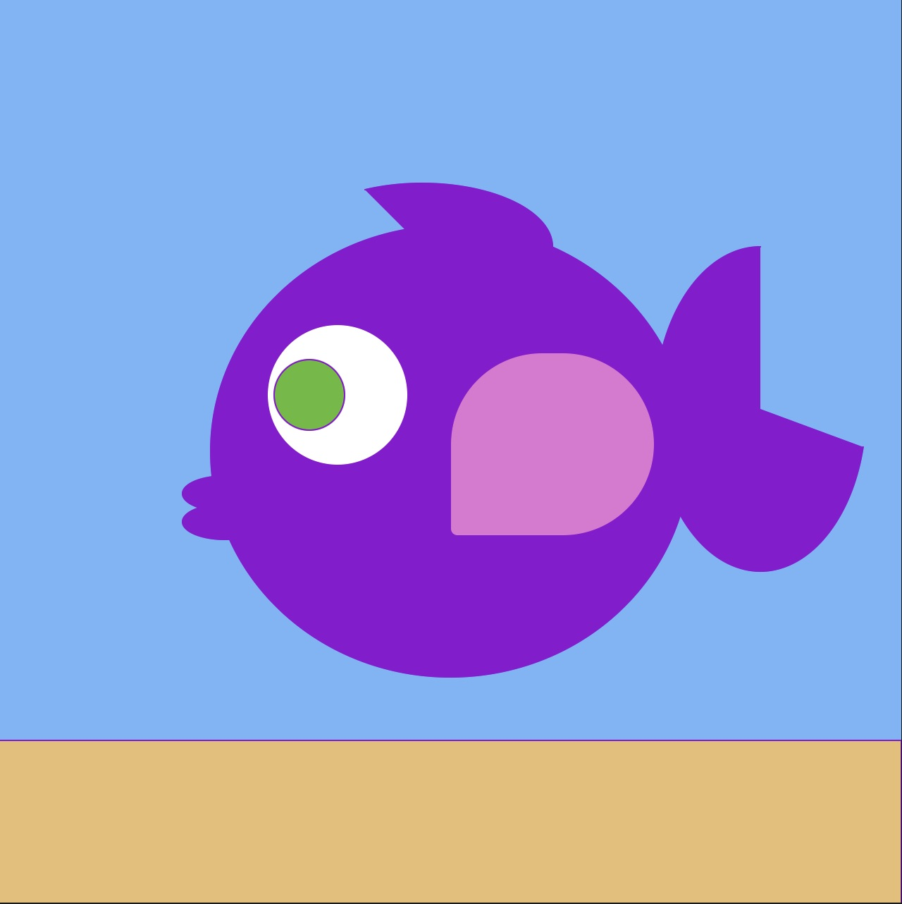
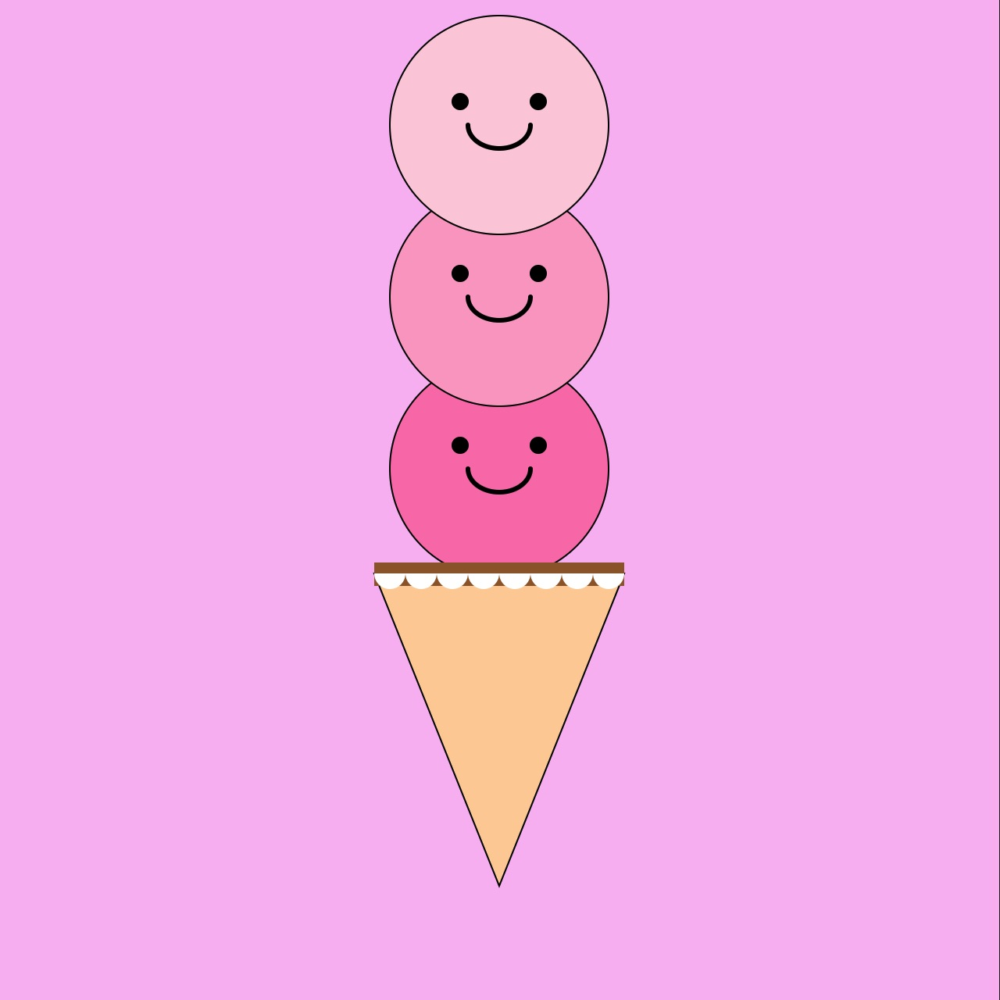
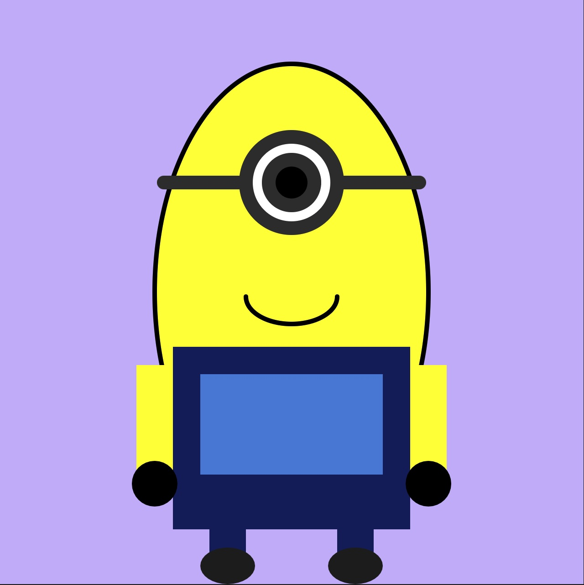
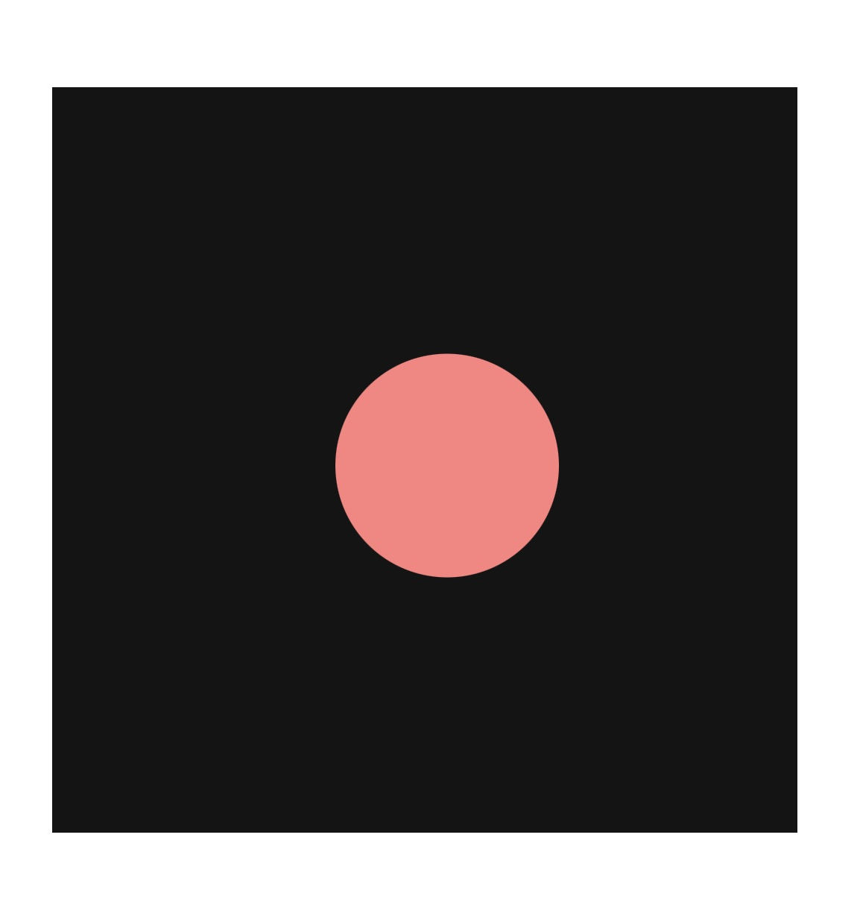

# Journal.md
## Alycia's Reflective Coding Journal 2026

### ***Process Journal*** – Making my website with Markdown & GitHub (Week 2 - Sept 13):

The image code gave me so much trouble, I kept getting it wrong and couldn't figure out why my image wasn't showing up. I also spent a long time trying to change the font and size of my title and subheading bc it looked weird at first and I just kept messing with it till it looked right.

Honestly, a lot of this is still hard for me to fully understand because I don't have much prior coding background to build on. I'm kind of learning the "why" behind the code as I go, instead of already knowing it.

What I hope is that when people (including future me) look back at this project, they can actually see the evolution. Where I start from really basic formatting and slowly moving into more detailed, cleaner edits and smarter coding techniques. I want that growth to be visible. My biggest goal is to eventually memorize these codes and techniques instead of constantly relying on cheat sheets. I want it to feel natural instead of like I'm decoding a puzzle every time. Slow progress is still progress.

### ***Process Journal*** – Making my 3 prototype projects P5 & GitHub (Week 3 - Sept 14):

This week’s prototypes were more about layering and figuring things out than I expected. I started with a fish made from basic shapes, then made a triple-scoop ice cream cone, and finished with an “abstract minion” using ellipses, rectangles, and arcs. I realized that a lot of making these characters is just putting simple shapes together in the right order. The minion especially showed me how much the layering matters.

The coolest part was seeing how far you can push basic shapes while still making them recognizable. Changing the arc angles to make a smile or scalloped edges felt like actual problem-solving instead of just placing random shapes.

The hardest part was definitely the coordinate math, especially making sure everything lined up properly when I resized things.

I hope people looking at my work can see how much personality you can create with simple shapes. I’d like to develop the minion more by making its eyes follow the mouse or making it “breathe.”

 Here are the prototypes; 
Prototype #1: 

Prototype #2: 

Prototype #3: 

### ***Process Journal*** – Making my 3 Variable Prototypes P5 & GitHub (Week 4- Sept 21):

This week I made three prototypes: Sunset, Heartbeat, and Nervous Dot. They all use variables to change different things while the program is running, but each one has its own feeling and purpose.What surprised me the most was how much you can do with simple math. In Sunset, the sun's position changes the colours of the sky using map(). In Heartbeat, I used sin() to make the heart pulse on its own, even when the mouse isn't moving. In Nervous Dot, random() makes the dot shake, and every click makes it bigger, redder, and more intense.

I also learned how useful JavaScript objects can be for keeping everything organized. The hardest part was understanding map() and getting the ranges right. Building the heart was also a bit tricky because I had to make sure all the shapes scaled properly together.

Overall, I liked seeing how a few variables and simple shapes could create different moods. I wanted Sunset to feel calm, Heartbeat to feel alive, and Nervous Dot to feel a little uncomfortable. If I continue working on Nervous Dot, I'd like to make the dot calm down over time or add sound to make the experience more intense.

 Here are the variable prototypes; 

Prototype #1: 

Prototype #2: 

Prototype #3: 

