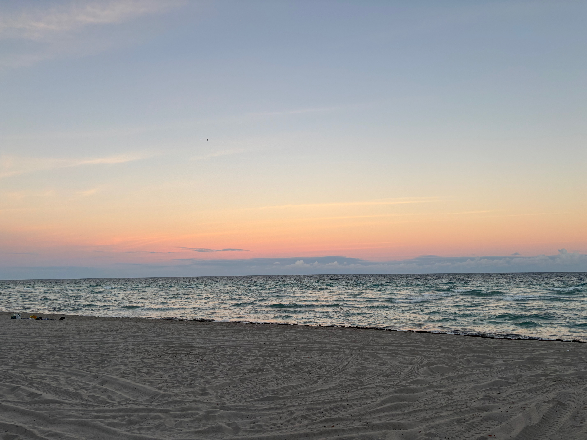

# Alycia Mal's **_CART253_**

This is Alycia Malonga’s coursework 2026 repository for CART253

This website will explore and present my prototyping work as a beginner in coding for course CART253.

Here are useful websites to use as a cheatsheet:

- To answer questions about Markdown, here is the [Guide](https://www.markdownguide.org/tools/vscode/).
- Here you will find my comments on how I've progressed throughout the week in my [Coding Journal](https://alyciamal17.github.io/CART253/Journal.html).
